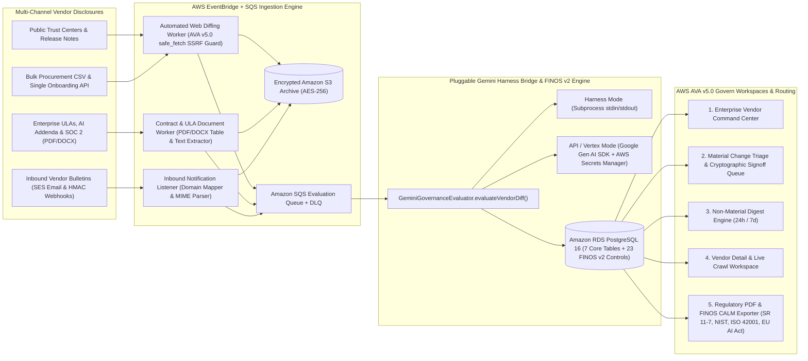

# Autonomous Enterprise AI Vendor Governance Platform

Continuously updating enterprise AI vendor governance platform aligned with the **FINOS AI Governance Framework v2** catalog, **FINOS Common Architecture Language Model (CALM v1.0)** specifications, and **AWS Agentic Value Accelerator v5.0 Govern** workspace patterns.

📖 **Full Documentation & Operational Manual**: See [**docs/USER_GUIDE_AND_ARCHITECTURE.md**](docs/USER_GUIDE_AND_ARCHITECTURE.md) for the complete multi-layer system architecture, sequence flows, entity-relationship diagram, and step-by-step User Experience Guide.

---

## 1. Architecture & Core Capabilities



### Core Relational Schema (`backend/app/models.py` & `backend/alembic/versions/0001_initial_schema_and_finos_v2.py`)
1. **`vendors`**: `vendor_id` (UUID PK), `legal_name`, `primary_domain`, `onboarding_status` (`pending`, `active`, `under_review`, `restricted`), `risk_tier` (`critical`, `high`, `medium`, `low`), `primary_owner_id`, `secondary_owner_id`, `created_at`, `updated_at`.
2. **`business_owners`**: `owner_id` (UUID PK), `external_idp_subject`, `full_name`, `email_address`, `department`, `notification_channel_preferences` (JSONB), `escalation_manager_id`, `created_at`, `updated_at`.
3. **`vendor_ai_capabilities`**: `capability_id` (UUID PK), `vendor_id`, `product_module_name`, `foundation_model_family`, `model_provider`, `hosting_topology` (`vendor_hosted`, `aws_bedrock`, `vertex_ai`, `azure_openai`, `on_premise`), `autonomy_classification` (`deterministic`, `assistive_copilot`, `tool_calling_agent`, `multi_agent_autonomous`), `mcp_or_a2a_enabled`, `trains_on_customer_data`, `data_retention_days`, `active_snapshot_id`.
4. **`ingestion_sources`**: `source_id` (UUID PK), `vendor_id`, `source_type` (`trust_center_url`, `release_notes_url`, `subprocessor_url`, `ula_contract_pdf`, `soc2_report`, `inbound_email_alias`), `target_uri_or_s3_key`, `polling_cron_schedule`, `last_polled_at`, `last_http_etag`, `last_sha256_hash`.
5. **`vendor_snapshots`**: `snapshot_id` (UUID PK), `source_id`, `vendor_id`, `raw_extracted_text`, `content_sha256_hash`, `s3_archive_uri`, `captured_at`.
6. **`materiality_assessments`**: `assessment_id` (UUID PK), `vendor_id`, `previous_snapshot_id`, `new_snapshot_id`, `materiality_level` (`material`, `non_material`, `baseline`), `executive_summary`, `detected_model_changes` (JSONB), `detected_agentic_changes` (JSONB), `impacted_finos_risk_ids` (text array), `recommended_actions`, `gemini_model_identifier`, `evaluated_at`.
7. **`governance_signoffs`**: `signoff_id` (UUID PK), `assessment_id`, `vendor_id`, `assigned_owner_id`, `review_status` (`awaiting_review`, `approved`, `rejected`, `mitigated`, `digest_sent`), `owner_decision_notes`, `cryptographic_signature_hash`, `decided_at`.
8. **`finos_risk_catalog`**: Pre-seeded with all **23 official FINOS AI Governance Framework v2 risk controls** (11 Operational, 9 Security, 3 Regulatory & Compliance) cross-mapped to US Fed SR 11-7, NIST AI RMF, ISO/IEC 42001, EU AI Act GPAI/Annex III, and FINOS CALM.

---

## 2. Local Verification & Production Execution Guide

### Step 1: Provision Backing Infrastructure (LocalStack + PostgreSQL 16 or AWS Terraform)
For local execution with real PostgreSQL 16 and LocalStack (S3, SQS, SES, Secrets Manager, EventBridge):
```bash
docker compose up -d
```
For AWS production deployment, apply the Terraform module in `infra/terraform/`:
```bash
cd infra/terraform
terraform init
terraform apply
```

### Step 2: Run Database Migrations & Seed the 23 FINOS v2 Controls
```bash
cd backend
pip install -r requirements.txt
alembic upgrade head
```

### Step 3: Configure the Gemini Execution Bridge
- **Harness Mode (Local/Staging)**:
  ```env
  GEMINI_EXECUTION_MODE=harness
  GEMINI_HARNESS_COMMAND="python -m app.inference.gemini_harness_cli"
  ```
- **API or Vertex Mode (Unattended Production on AWS ECS/EKS)**:
  Store your Gemini API key or Vertex AI project configuration in AWS Secrets Manager (`prod/vendor-governance/gemini-credentials`) and set:
  ```env
  GEMINI_EXECUTION_MODE=api   # or vertex
  ```

### Step 4: Start the FastAPI Backend & React Frontend Workspaces
```bash
# Terminal 1: FastAPI Governance Control Plane
cd backend
uvicorn app.main:app --host 0.0.0.0 --port 8000 --reload

# Terminal 2: React + TypeScript + Vite Govern Workspace
cd frontend
npm install
npm run dev
```

### Step 5: Import Procurement Baseline CSV
Upload `infra/procurement_vendors_baseline.csv` via the **Bulk CSV Intake** button in the **Enterprise Vendor Command Center** (or `POST /api/v1/vendors/bulk-csv`) to register baseline vendors, capabilities, EventBridge schedules, S3 snapshots, and initial Gemini materiality evaluations.
