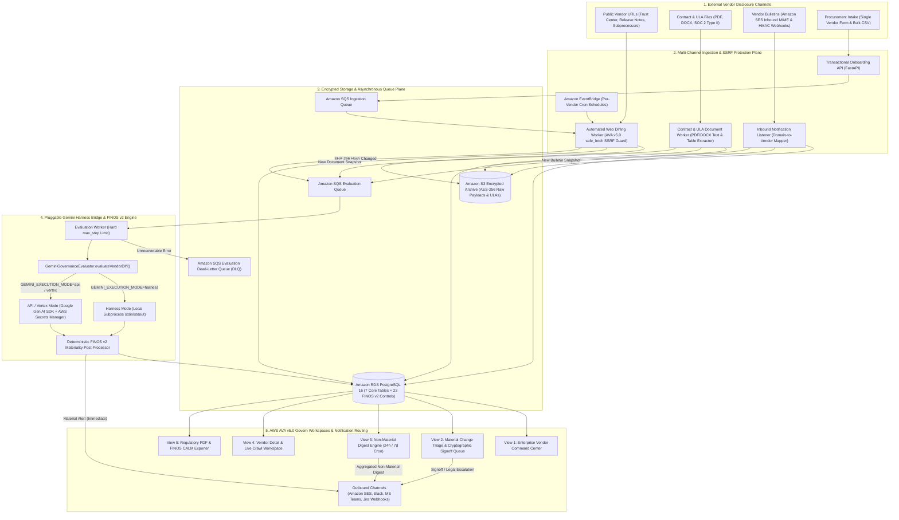
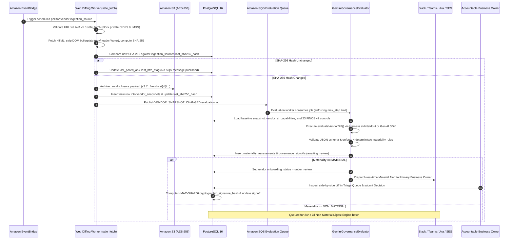
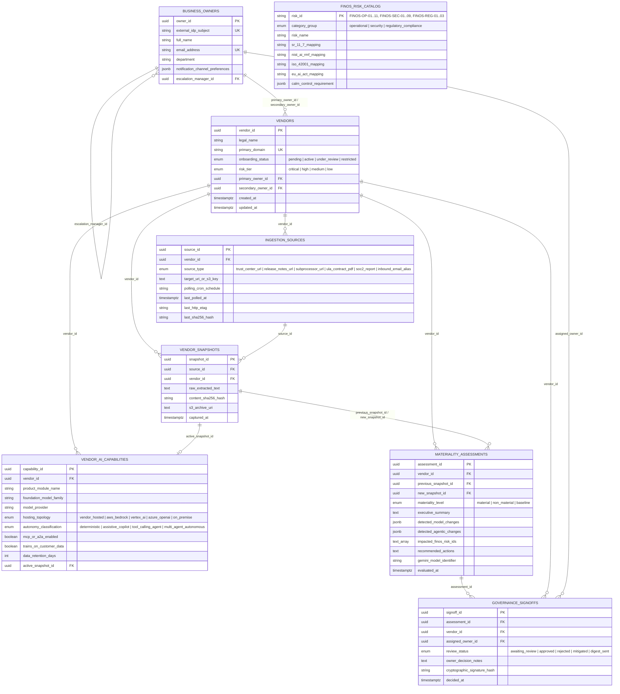

# Autonomous Enterprise AI Vendor Governance Platform
## Comprehensive Architecture & End-to-End User Guide

This document provides:
1. **System Architecture & Data Flow Diagrams** to articulate how the platform operates across ingestion, inference, storage, and compliance workspaces.
2. **Step-by-Step User Experience Guide** detailing how Business Owners, Model Risk Officers, Procurement Leads, and Compliance Auditors accomplish every task in the application.

---

## Part 1: System Architecture & Technical Articulation

### 1.1 High-Level Reference Architecture (AWS AVA v5.0 Govern + FINOS v2)

The platform is engineered around four decoupled planes:
1. **Multi-Channel Disclosure Ingestion Plane**: Continuously collects vendor disclosures from public web URLs (Trust Centers, Release Notes, Subprocessor lists), contractual documents (ULAs, AI Addenda, SOC 2 Type II PDFs/DOCX), inbound vendor bulletins (Amazon SES & HMAC-signed webhooks), and bulk procurement CSVs.
2. **Event-Driven Persistence & Queueing Plane**: Archives every raw disclosure in an AES-256 encrypted Amazon S3 bucket, stores normalized text and SHA-256 hashes in Amazon RDS for PostgreSQL 16, and routes change events through Amazon SQS (with Dead-Letter Queue protection).
3. **Pluggable Gemini Harness Bridge & FINOS v2 Materiality Plane**: Executes [`GeminiGovernanceEvaluator.evaluateVendorDiff()`](../backend/app/inference/gemini_evaluator.py) via either the local Gemini Harness CLI subprocess (`GEMINI_EXECUTION_MODE=harness`) or the Google Gen AI / Vertex AI SDK (`GEMINI_EXECUTION_MODE=api` or `vertex`) using runtime secrets from AWS Secrets Manager. Every diff is evaluated against the **23 official FINOS AI Governance Framework v2 risk controls**.
4. **AWS AVA v5.0 Govern Workspace & Regulatory Export Plane**: Serves five specialized operator views and generates examination-ready PDF and machine-readable JSON exports mapped to **US Fed SR 11-7**, **NIST AI RMF**, **ISO/IEC 42001**, **EU AI Act (GPAI & Annex III)**, and **FINOS CALM v1.0**.

---

### 1.2 End-to-End Sequence Flow: From Disclosure Detection to Cryptographic Signoff

Use this sequence diagram when walking stakeholders through what happens when a third-party AI vendor silently updates its Trust Center, swaps foundation models, or introduces autonomous MCP/A2A capabilities:

---

### 1.3 Relational Entity-Relationship Diagram (7 Core Tables + FINOS v2 Catalog)

---

## Part 2: End-to-End User Experience & Task Guide

The web application is organized into **five specialized workspaces** in the top navigation bar, plus a global **Inbound Listener** drawer. Below is the operational guide for accomplishing every core governance workflow.

---

### Workflow 1: Registering Accountable Business Owners
Before onboarding vendors manually, register the corporate business owners who hold risk accountability for third-party AI capabilities.

1. Navigate to the **Command Center** tab (default home view).
2. Click the **Add Business Owner** button in the top-right action bar.
3. Fill in the owner attributes:
   - **Full Name**: e.g., `Elena Rostova`
   - **Corporate Email**: e.g., `elena.rostova@enterprise.com`
   - **Department**: e.g., `Quantitative Model Risk`
   - **External OIDC Subject (`sub`)**: Your corporate IdP / AWS Cognito subject claim (e.g., `oidc:cognito:elena.rostova`). This binds cryptographic signoff hashes to verified corporate identities.
   - **Slack Webhook URL (Optional)**: Paste a channel webhook URL to route real-time Material alerts and Non-Material digests directly to Slack.
4. Click **Save Business Owner**. The owner is immediately persisted to `business_owners` in PostgreSQL and available in all filter and onboarding dropdowns.

---

### Workflow 2: Onboarding AI Vendors (Bulk Procurement CSV vs. Single Vendor)

#### Option A: Bulk Procurement CSV Intake (Hundreds of Vendors at Once)
1. In the **Command Center** top-right action bar, click **Bulk CSV Intake**.
2. Select a CSV file formatted like [`infra/procurement_vendors_baseline.csv`](../infra/procurement_vendors_baseline.csv), containing columns:
   - `legal_name`, `primary_domain`, `risk_tier`, `owner_email`, `owner_name`, `owner_department`
   - `product_module_name`, `foundation_model_family`, `model_provider`, `hosting_topology`, `autonomy_classification`, `mcp_or_a2a_enabled`, `trains_on_customer_data`, `data_retention_days`
   - `trust_center_url`, `baseline_disclosure_text`
3. Upon upload, the backend transactionally:
   - Creates or updates the `business_owners`, `vendors`, `vendor_ai_capabilities`, and `ingestion_sources` records.
   - Registers recurring AWS EventBridge polling schedules.
   - Archives the initial baseline snapshots to encrypted S3 (`s3://enterprise-ai-vendor-governance-archives/...`).
   - Runs `GeminiGovernanceEvaluator.evaluateVendorDiff()` to establish the baseline assessment for every imported vendor.

#### Option B: Single Vendor Onboarding Modal
1. Click **Onboard AI Vendor** in the top-right action bar of the **Command Center**.
2. Enter the **Vendor Legal Name**, **Primary Domain** (e.g., `anthropic.com`), **Risk Tier** (`critical`, `high`, `medium`, `low`), and select the **Accountable Business Owner**.
3. Define the initial **AI Capability & Model Lineage**:
   - **Product Module**, **Foundation Model Family**, and **Model Provider**
   - **Hosting Topology**: `vendor_hosted`, `aws_bedrock`, `vertex_ai`, `azure_openai`, or `on_premise`
   - **Autonomy Classification**: `deterministic`, `assistive_copilot`, `tool_calling_agent`, or `multi_agent_autonomous`
   - Toggle **MCP Server or A2A Protocol Enabled** and **Trains on Customer Data**, and specify **Data Retention (Days)**.
4. Optionally attach an initial **Monitored Ingestion URL** (`Trust Center URL`, `Release Notes URL`, or `Subprocessor List URL`).
5. Click **Onboard & Schedule Baseline**.

---

### Workflow 3: Filtering & Monitoring the Enterprise Vendor Command Center
1. Review the **five live KPI cards** at the top of the **Command Center**:
   - **Total Vendors Monitored**: Total count of active vendor records in PostgreSQL.
   - **Material Alerts Awaiting Sign-Off**: Count of unreviewed `material` assessments (click this card to jump straight to the **Material Triage & Signoff Queue**).
   - **Autonomous / Agentic Vendors**: Percentage of vendors operating with `tool_calling_agent`, `multi_agent_autonomous`, or MCP/A2A protocols enabled.
   - **Critical / High Risk Tier**: Vendors subject to heightened SR 11-7 and EU AI Act Annex III scrutiny.
   - **Encrypted S3 Snapshots**: Total immutable, SHA-256 verified disclosure snapshots stored in S3.
2. Use the **Instant Server-Side Inventory Filtering** bar to slice the vendor grid by:
   - Free-text search across vendor name, domain, owner, module, or model family
   - **Risk Tier** (`critical`, `high`, `medium`, `low`)
   - **Business Owner**
   - **Foundation Model Family** (e.g., `Claude`, `GPT-4o`, `Gemini`)
   - **Autonomy Classification**
   - **Signoff Status** (`awaiting_review`, `approved`, `mitigated`, `rejected`, `digest_sent`)

---

### Workflow 4: Inspecting a Vendor, Uploading ULA/SOC 2 Documents, & Forcing a Live Crawl
Click any row in the Command Center (or click **Inspect & Crawl →**) to open the **Vendor Detail & Source Configuration Workspace**:

1. **Inspect Active AI Capabilities**: View the live model family, fourth-party provider, hosting topology, autonomy classification, MCP/A2A status, and Zero Data Retention (ZDR) status. If a subsequent Gemini evaluation detects a model swap or agentic upgrade, this inventory updates automatically.
2. **Upload Enterprise ULA, AI Addendum, or SOC 2 Reports (PDF / DOCX)**:
   - In the **Contract, ULA & SOC 2 Document Ingestion** card, select either `Enterprise ULA / AI Addendum (PDF/DOCX)` or `SOC 2 Report (PDF/DOCX)`.
   - Click **Upload PDF / DOCX** and choose your file.
   - The worker extracts all text and tabular disclosures, archives the encrypted binary in S3, saves a `vendor_snapshots` row, and immediately runs Gemini materiality evaluation against the prior snapshot.
3. **Add Additional Monitored URLs**:
   - In the **Add Monitored URL or Inbound Alias** form, select the source type (`trust_center_url`, `release_notes_url`, `subprocessor_url`, `inbound_email_alias`), enter the URL and cron schedule (default `0 */6 * * *`), and click **+**.
4. **Force Immediate Live Crawl & Gemini Harness Evaluation**:
   - Select a monitored source from the dropdown.
   - Leave the override box blank to execute a real SSRF-safe HTTP fetch (`safe_fetch`) against the live URL, **or** paste updated policy/release-notes text into the **Optional Live Policy / Release Notes Payload Override** box to test how the Gemini evaluator classifies a specific vendor policy shift.
   - Click **Force Live Crawl & Gemini Evaluation**.
   - Scroll down to the **Historical Gemini Materiality Assessments** and **Archived S3 Snapshots** timelines to see the new snapshot, its SHA-256 hash, its S3 archive URI, and the triggered FINOS v2 risk codes.

---

### Workflow 5: Ingesting Inbound Vendor Bulletins (SES Email & Webhook Listener)
When a vendor sends a product update or security bulletin email/webhook:

1. Click **Inbound Listener** in the top-right header bar (or POST directly to `/api/v1/ingestion/webhooks/vendor-bulletin` or `/api/v1/ingestion/ses/inbound`).
2. Enter:
   - **Sender Email or Vendor Domain**: e.g., `security-bulletins@anthropic.com` (the listener automatically maps the sender domain or subdomain to the registered `vendor_id`).
   - **Bulletin Subject**: e.g., `Q4 Update: Introduction of Autonomous MCP Server Execution`
   - **Bulletin / SES Email Body**: Paste the vendor announcement text.
3. Click **Ingest & Evaluate Bulletin**. The payload is archived to S3, stored as a snapshot, and evaluated by `GeminiGovernanceEvaluator`.

---

### Workflow 6: Triaging Material Alerts & Executing Cryptographic Signoffs
When any vendor update triggers one of the four deterministic Materiality conditions (autonomous/MCP/A2A introduction, model family/geography/fourth-party change, customer data training/retention change, or FINOS v2 severity increase), it is routed to the **Material Triage & Signoff** workspace:

1. Click **Material Triage & Signoff** in the top navigation bar.
2. Select an alert from the left queue panel.
3. Review the **Gemini Governance Evaluator Executive Summary** and **Recommended Actions**.
4. Inspect the **Triggered FINOS AI Governance Framework v2 Controls** cards—each card displays the exact FINOS Risk ID (e.g., `FINOS-OP-08`, `FINOS-SEC-05`, `FINOS-REG-01`), category group, and cross-mappings to **SR 11-7**, **NIST AI RMF**, and **EU AI Act**.
5. Examine the **Side-by-Side ULA / Web Snapshot Visual Diff**, which highlights removed baseline clauses in red (`-`) and newly added vendor clauses in green (`+`).
6. In the **Accountable Business Owner Cryptographic Signoff** box at the bottom:
   - Enter mandatory governance audit rationale, compensating controls, or remediation requirements (minimum 5 characters).
   - Click one of the three governance decision actions:
     - **Approve Material Change**: Sets `review_status = approved` and restores vendor `onboarding_status = active`.
     - **Require Vendor Remediation**: Sets `review_status = mitigated` and keeps vendor `onboarding_status = under_review`.
     - **Escalate to Legal & Restrict**: Sets `review_status = rejected`, transitions vendor `onboarding_status = restricted`, and reassigns escalation to the owner's `escalation_manager_id`.
7. Every decision generates an immutable HMAC-SHA256 `cryptographic_signature_hash` binding the corporate OIDC identity, timestamp, assessment ID, and decision notes, and dispatches confirmation notifications.

---

### Workflow 7: Managing the Non-Material Digest Engine
Minor vendor updates (UI typography tweaks, latency optimizations, documentation formatting) are classified as `non_material` so Business Owners are not fatigued by real-time alerts (`FINOS-OP-11: Human oversight fatigue`).

1. Click **Non-Material Digests** in the top navigation bar.
2. Toggle between **Prior 24 Hours** (`24h`) and **Prior 7 Days** (`168h`) to preview all `non_material` assessments grouped by their accountable Business Owner.
3. Click **Dispatch Digest Batch Now** (which also runs on an automated schedule via AWS EventBridge).
4. The engine dispatches a consolidated summary email (via Amazon SES) and Slack/Teams webhook digest to each owner and marks all included signoff records as `digest_sent` with a cryptographic audit signature.

---

### Workflow 8: Generating Regulatory Examination Packs & FINOS CALM Exports
To prepare for supervisory examinations, internal audit, or Governance-as-Code pipeline checks:

1. Click **Regulatory & CALM Exporter** in the top navigation bar.
2. Select one of the five regulatory lenses:
   - **Unified Examination Pack**: Combined multi-framework report.
   - **US Fed SR 11-7**: Model Risk Management Inventory, tiering, conceptual soundness, ongoing monitoring, and effective challenge signoff hashes.
   - **NIST AI RMF & ISO 42001**: Control matrix mapping all 23 FINOS v2 risks to NIST `GOVERN`, `MAP`, `MEASURE`, `MANAGE` functions and ISO/IEC 42001 Annex controls with active vendor exposure counts.
   - **EU AI Act GPAI & Annex III**: General-Purpose AI foundation model lineage, Annex III high-risk flags, Article 10 Zero Data Retention compliance, and Article 14 human oversight owners.
   - **FINOS CALM v1.0**: Machine-readable Common Architecture Language Model JSON (`nodes`, `relationships`, `controls`) conforming to `https://calm.finos.org/release/1.0/meta/calm.json`.
3. Click **Download PDF Examination Pack** to generate and download a formatted PDF report (built live via ReportLab with SHA-256 artifact integrity verification).
4. Click **Export Machine-Readable JSON / CALM** to download the JSON compliance artifact for automated CI/CD policy gates.
